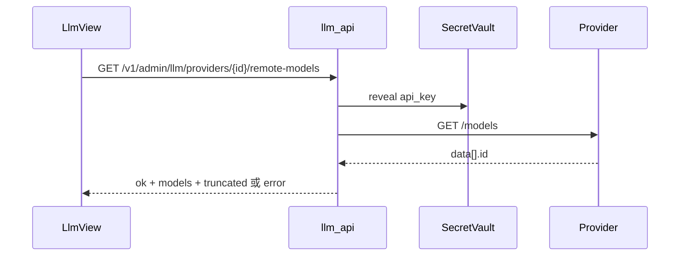

# LLM 按提供方拉取远端模型列表

**日期：** 2026-10-28  
**状态：** **已交付**（2026-10-28）  
**权威设计：** [`docs/design/2026-10-09-oa-langgraph-design.md`](../../design/2026-10-09-oa-langgraph-design.md)  
**交付：** [`docs/delivery/2026-10-28-llm-remote-models-delivery.md`](../../delivery/2026-10-28-llm-remote-models-delivery.md)

---

## 1. 目标

管理员在 LLM 配置页**新增/编辑模型**时，按所选提供方从 OpenAI 兼容 `GET {base_url}/models` 拉取远端模型 ID 列表，用可搜索下拉选择 `model_name`，并允许手填未列出的名称；列表失败不阻塞保存。

---

## 2. 硬约束

1. 提供方类型仍仅为 `openai_compatible`；不引入 Anthropic/Azure 专用协议。  
2. 密钥只写不读：列表接口服务端 vault 解密后出站，响应不得含 Key。  
3. 列表为只读探测：权限 `sys.setting.view`，**不写审计**。  
4. 不伪造模型列表；无 Key / 提供方失败如实返回错误。  
5. 不缓存到 DB；每次打开对话框、切换提供方或点刷新时实时拉取。

---

## 3. 架构与数据流



- 内部复用并扩展 `integrations/llm_check.check_provider`。  
- `check_provider` 增加可选 `limit`：默认 **50**（保持现有「提供方测试」行为）；remote-models 传 **200**。  
- 返回 `model_count` 为解析到的全量条数；`models` 为截断后列表；`truncated = (全量 > limit)`。

---

## 4. API 契约

```
GET /v1/admin/llm/providers/{provider_id}/remote-models
权限: sys.setting.view
```

成功：

```json
{
  "ok": true,
  "latency_ms": 120,
  "model_count": 35,
  "truncated": false,
  "models": ["deepseek-chat", "deepseek-reasoner"]
}
```

失败（HTTP 200 业务体，与现有 provider test 一致）：

```json
{ "ok": false, "error": "…" }
```

- 提供方不存在或不属于本租户 → **404**。  
- 未配置 API Key → `ok: false`，明确错误文案（不调用远端猜模型）。  
- 远端 HTTP/超时/非 200 → `ok: false`，`error` 经 `redact()`。

不改模型 CRUD 字段。

---

## 5. 前端交互（`LlmView.vue`）

- `model_name`：`el-select`，`filterable` + `allow-create` + `default-first-option`。  
- 打开新增/编辑（已有 `provider_id`）及切换提供方时拉取；编辑保留当前 `model_name`（不在列表仍显示）。  
- 选中列表项且 `display_name` 为空时自动填入所选名；用户已改显示名不覆盖。  
- 「刷新」按钮可手动重拉。  
- 加载中 select loading；失败/空列表/`truncated` 用提示，不关对话框、不清空手填值。

| 情况 | 行为 |
|------|------|
| 拉取中 | select loading |
| 无 Key / 网络或 HTTP 失败 | 提示错误；可手填 |
| `ok` 但 `models` 为空 | 提示未返回列表；可手填 |
| `truncated: true` | 提示仅显示前 200 个，可搜索或手填 |

---

## 6. 测试

- 有 Key：`respx` mock `/models` → 返回 id、`truncated`。  
- 无 Key / HTTP 失败 → `ok: false`，无明文 Key。  
- 提供方不存在 → 404。  
- 无 `sys.setting.view` → 403。  
- `limit` 截断行为（单元或 API 层）。

---

## 7. 范围外

- 非 OpenAI 兼容协议、静态内置 catalog、批量一键导入多模型。  
- 改流程配置里的模型下拉数据源。  
- 用本接口替换「提供方测试」UI。

---

## 8. 文件清单

- `backend/oa_agent/integrations/llm_check.py`  
- `backend/oa_agent/admin/llm_api.py`  
- `backend/tests/test_llm.py`  
- `frontend/src/admin/views/LlmView.vue`  
- `docs/design/2026-10-09-oa-langgraph-design.md` §9/§12  
