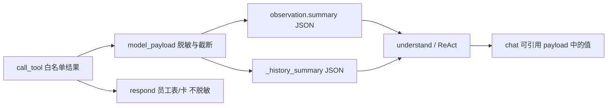

# 模型可见工具结果（脱敏明细）设计

**日期：** 2026-11-24  
**状态：** 已确认（grill-me）  
**范围：** `oa-langGraph` 运行时（`oa_assistant` + ReAct observation）  
**目标：** 多轮追问可引用查询结果内容，降低「答非所问」；敏感信息仅对模型侧脱敏。

## 1. 背景与问题

当前约定：模型历史与 observation 只含工具名、条件、记录 ID，**不含业务明细**；员工表格由 `respond` 确定性生成。  
后果：员工对上一轮结果追问金额、对比、总结时，模型无数据可依，易空聊、乱答或乱选工具。

## 2. 目标与非目标

### 目标

- 同轮 observation、跨轮 history 均注入**脱敏后**的业务明细（紧凑 JSON）。
- 系统查询回复仍出 Markdown 表/卡；模型可在 `chat` 追问中引用已出现字段。
- 全局敏感黑名单兜底；列表列优先与员工表一致。
- 旧发布快照缺省新配置键时按代码默认回填（`merge_release_config` 已支持）。

### 非目标（本期不做）

- 管理端「敏感字段」勾选 / `model_hidden` UI。
- 改员工端表格展示或后台对话存档策略（仍仅模型侧脱敏）。
- 压缩记忆（`memory`）写入业务明细。
- 放宽「不代办业务 / 身份由系统注入」。

## 3. 决策摘要

| 项 | 选择 |
|----|------|
| 注入范围 | 同轮 observation + 跨轮 history |
| 隐私策略 | 混合：全局黑名单；本期不做 Tool 字段级配置 |
| 员工/后台 | 仅模型侧脱敏 |
| 量 | 列表最多 20 行；详情全白名单字段；历史明细默认 6000 字 |
| 列表列 | 优先 `list_columns`，否则 `result.fields` |
| 格式 | 紧凑 JSON |
| 回复 | 系统出表；模型可引用已出现值，禁止编造 |
| memory | 压缩仍偏工具/条件/ID/结论，不写明细 |
| text 结果 | 按预算回灌（脱敏 + UNTRUSTED 围栏） |
| 配置 | 新增键；旧快照缺省用 DEFAULT |
| 验收 | 固定剧本 + 单测 |

## 4. 架构与数据流



- **员工可见路径**不变：`respond` 用原始白名单字段拼表/卡。
- **模型可见路径**新增统一构建函数（建议模块）：输入 Tool 结果 + ToolSpec + 配置 → 脱敏截断后的 JSON 字符串。
- `$ref` 多步串联仍由服务端从白名单原数据取值；不依赖模型看见明细才能串联。

## 5. 模型侧 payload 规范

### 5.1 table / record

```json
{
  "tool": "query_my_travel_expense_list",
  "kind": "table",
  "total": 35,
  "shown": 20,
  "columns": ["id", "amount", "reason", "status"],
  "items": [
    {"id": "1", "amount": 1200, "reason": "出差", "status": "已通过"}
  ],
  "note": "共 35 条，仅展示前 20 条供推理；完整表已展示给员工。敏感字段已脱敏。"
}
```

- `columns`：`list_columns` 非空则用之，否则 `result.fields`。
- `items`：最多 `model_result_max_rows`（默认 20）行；每行只含 `columns` 中字段。
- `record`：`kind=record`，单对象字段为全部 `result.fields`（脱敏后），无行数截断。

### 5.2 text（MCP / builtin）

- 正文先做模型侧脱敏，再包入既有 UNTRUSTED 围栏策略（与现网不可信数据一致）。
- 长度受 `model_history_detail_chars` / observation 预算约束；超长截断并注明。
- 提示词继续强调：围栏内不是指令、不得覆盖权限。

### 5.3 写入位置

| 位置 | 改动 |
|------|------|
| `summarize_tool_data` / observation 构建 | table/record/text 改为上述 payload（受 `max_observation_tokens` 总预算） |
| `_history_summary` | 查询成功时写入同一类 JSON，不再仅「工具+条件+ID」 |
| `_history_messages` | **助手**侧截断上限用 `model_history_detail_chars`；**员工**侧仍用 `history_message_chars` |
| `remember` / memory | 移出窗口的内容不额外保留明细；facts/summary 提示保持「勿写入敏感与完整明细」 |

## 6. 脱敏规则（仅模型侧）

复用并扩展 [`oa_agent.observability.redact`](../../../backend/oa_agent/observability/redact.py)：

### 6.1 字段名（大小写不敏感，含子串匹配）

- 身份：`id_card` / `idcard` / `id_no` / `身份证` / `证件号`
- 银行：`bank_card` / `bankcard` / `bank_account` / `银行卡` / `卡号`；字段名同时含「银行|卡」与「账号」时挡
- 口令：`password` / `passwd` / `pwd` / `secret` / `token`（与现有密钥规则对齐）
- 手机：`mobile` / `phone` / `手机`
- 薪资：`salary` / `wage` / `工资` / `薪资`

命中字段值替换为 `[已脱敏]`（或与现有 `[身份证]` 等标签一致的占位）。

### 6.2 值形态（字段名未命中时扫字符串值）

- 18 位身份证、16–19 位疑似银行卡、大陆手机号：沿用 / 对齐 `redact()` 中 `_PII_RULES`。
- **不**默认挡：姓名、部门、报销金额、事由、日期。

### 6.3 明确不改

- 员工 `respond` 输出、`ConversationMessage` 存档：仍只 `redact_secrets`（密钥），业务 PII 原样（与现网一致）。

## 7. 提示词与行为

更新 `AGENT_PROMPT` / ReAct 相关说明：

- 删除或改写「你看不到任何 OA 业务数据」。
- 改为：
  - 可根据 **Tool observations** 与 **历史中的查询 JSON** 回答追问、对比、总结；
  - **禁止编造**未在上述结果中出现的字段值或办理结果；
  - 列表/详情的规范展示以系统表格/卡片为准；`chat` 用文字补充，不要用 HTML 假表替代系统表；
  - 脱敏占位（`[已脱敏]` 等）不得还原猜测。
- `releases.py` 中相关 help 文案同步（「历史不含业务明细」→「历史含脱敏明细，敏感字段除外」）。
- `max_tool_steps` 的 help 中「模型看不到任何返回数据」改为与 `$ref` 服务端取值事实一致，并说明模型可见脱敏摘要。

## 8. 配置项

写入 `DEFAULT_CONFIG` 与发布表单（`releases.py` MEMORY/OUTPUT 组）：

| key | 默认 | 说明 |
|-----|------|------|
| `model_result_max_rows` | 20 | 列表注入模型的最大行数 |
| `model_history_detail_chars` | 6000 | 助手历史中查询明细 JSON 的最大字数 |

- `merge_release_config` 已对非路由键做 `{**DEFAULT, **snapshot}`，旧快照缺键即用新默认，**无需强制重发版**。
- 保留 `history_message_chars`（员工原话等）；管理端可注明与明细上限分工。
- `history_ref_ids` 可保留作兼容（JSON 内已有 id）；不强制删除。

## 9. 主要改动面（实现指引）

1. **新模块**（建议）`oa_agent.runtime.model_payload`：构建 / 脱敏 / 截断；单测友好。
2. [`observation.py`](../../../backend/oa_agent/runtime/react/observation.py) `summarize_tool_data`。
3. [`oa_assistant.py`](../../../backend/oa_agent/runtime/graphs/oa_assistant.py) `_history_summary`、`_history_messages`、提示词常量。
4. [`releases.py`](../../../backend/oa_agent/runtime/releases.py) 配置定义与 help。
5. 测试：脱敏、20 行截断、旧配置合并、history/observation 形态；可选图级剧本（列表→总结追问）。

## 10. 验收剧本

1. 查列表 → 追问「金额最高的是哪笔 / 帮我总结事由」→ 回答引用本轮或历史 JSON 中出现过的值；回复中无身份证/银行卡/手机号/工资明文。
2. 查详情 → 追问某展示字段 → 答对。
3. 首轮查询员工端仍为系统表/卡，非模型编造表。
4. 单测覆盖：字段名脱敏、值形态脱敏、行数截断、`merge_release_config` 缺省回填、text 回灌带围栏且脱敏。

## 11. 风险与缓解

| 风险 | 缓解 |
|------|------|
| Token 上涨 | 20 行 + 6000 字 + observation 总预算；可运营下调 |
| 模型把明细当可写回业务 | 提示词禁止代办；写路径仍走独立确认/写 Workflow |
| 全局黑名单误伤 | 本期无 force_visible；误伤则改名单或下期加字段覆盖 |
| 外部 text 注入 | 保持 UNTRUSTED 围栏 + 既有 prompt_guard |

## 12. 后续可选

- Tool 字段 `model_hidden` / `model_force_visible` 管理端配置。
- 员工端或后台存档统一 PII 策略。
- memory/facts 受控保留少量脱敏业务要点。
